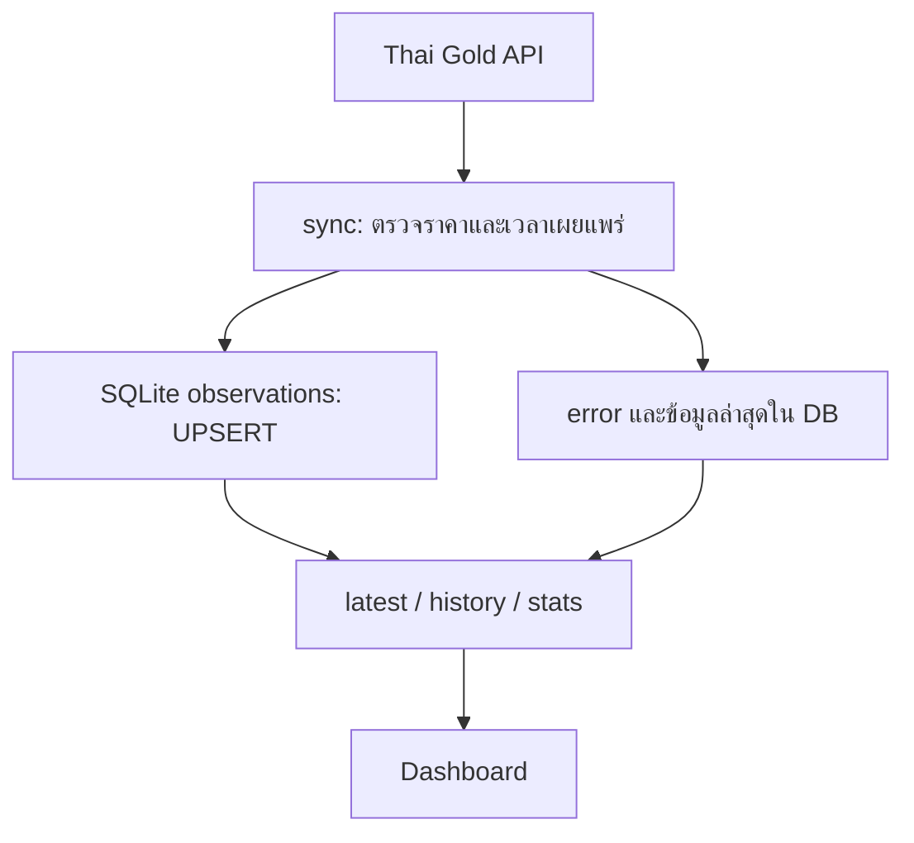

# ขอบเขตที่ตรวจสอบจากระบบจริง

Repository: `intasan/thai-gold-price-forecast`
ฐาน source ที่ตรวจ: `dc33808bcb6be377add2b486f02efae9f90632d5`

**สถานะ: รันรวบรวมข้อมูลจริงได้; ยังไม่มี forecast**

รัน HTTP API, query SQLite และจับภาพ Dashboard จริงได้; มีราคาจริง 1 publication; ไม่แสดง forecast/MAE/RMSE เพราะยังไม่มี chronological holdout

## แหล่งหลักฐาน

- [evidence/source-audit.json](../evidence/source-audit.json)
- [evidence/live-verification.txt](../evidence/live-verification.txt)

## Traceability จาก source

| ไฟล์ที่ตรวจ | ขอบเขตที่ยืนยันได้ |
|---|---|
| [server.js](../server.js) | พบ source ใน commit ข้างต้น; การมีไฟล์ไม่ใช่การทดสอบผ่าน |

## เกณฑ์ตรวจรับ BA / SA

| เกณฑ์ | หลักฐาน / สถานะ |
|---|---|
| ขอบเขตปัจจุบันตรงกับ source | รันรวบรวมข้อมูลจริงได้; ยังไม่มี forecast |
| End-to-end ด้วยข้อมูลจริง | รัน HTTP API, query SQLite และจับภาพ Dashboard จริงได้; มีราคาจริง 1 publication; ไม่แสดง forecast/MAE/RMSE เพราะยังไม่มี chronological holdout |
| ผลการทดสอบที่ทำซ้ำได้ | อ่าน command, stdout, exit code ใน evidence; syntax check ไม่ใช่ runtime test |
| ข้อมูลจริงและ provenance | เฉพาะราคาทองใน live-verification.txt ที่มี URL/เวลา publication; ไม่ใช้ fixture เป็นข้อมูลจริง |
| UAT โดยเจ้าของงานหรือผู้ใช้งาน | ยังไม่ได้ดำเนินการในรอบนี้ |

## ข้อจำกัดการแสดงผลงาน

ผล unit tests เป็นการตรวจ logic โดยมี fixture ตาม suite เดิม ไม่ใช่หลักฐานธุรกรรมจริง การฝึกโมเดลจริง การทำงานของอุปกรณ์จริง หรือการรับรองจากผู้ใช้ ไม่สร้างข้อมูลธุรกิจทดแทนข้อมูลที่ขาด และไม่อนุมานว่าไม่มีข้อมูลเท่ากับปลอดภัย

## Requirements ที่ตรวจจาก implementation ปัจจุบัน

| ID | Requirement / Acceptance criteria | Source / ผลรัน |
|---|---|---|
| FR-01 | ดึงราคาจาก endpoint จริง โดยมี timeout 12 วินาที | `server.js:sync`; live-verification.txt มี URL และ publication |
| FR-02 | ปฏิเสธราคาไม่เป็นตัวเลข ราคาศูนย์ หรือลบ และเวลาเผยแพร่ที่ขาด | `server.js:number` และ validation ใน `sync`; ยังไม่มี negative upstream test ในรอบนี้ |
| FR-03 | publication เดียวกันไม่เพิ่มจำนวน observation | PRIMARY KEY `(source,published_date,published_time)` และ UPSERT; query DB พบ 1 publication |
| FR-04 | API history รับ days เป็นจำนวนเต็ม 1–3650 | `/api/history?days=abc` ได้ HTTP 400 จริง |
| FR-05 | เมื่อ upstream ใช้ไม่ได้ ให้แสดงข้อมูลเดิมพร้อมสถานะ; ไม่มีข้อมูลให้แสดงว่ายังไม่มีข้อมูลจริง | `/api/latest` ส่ง `live`, `last`, `error`; ภาพ Dashboard แสดงสถานะใช้ข้อมูลเก่า |
| FR-06 | ไม่แสดง forecast / MAE / RMSE จนกว่าจะมีการประเมินตามเวลา | `/api/stats` ส่ง null และ not_evaluated จริง |
| NFR-01 | จัดเก็บข้อมูลคงทนด้วย SQLite WAL | query schema และข้อมูลใน `evidence/live-verification.txt` |
| NFR-02 | ติดตั้งได้บน Node.js 24 โดยไม่ต้อง build native better-sqlite3 | เปลี่ยนเป็น `node:sqlite`; การรัน HTTP รอบนี้สำเร็จ |

## Context / Data Flow จากระบบจริง

## Data Model

`observations`: source, published_date, published_time, retrieved_at, goldbar_buy, goldbar_sell, ornament_sell. Primary key คือ source + published_date + published_time. ฐานข้อมูลเดิม `gold_prices` ไม่ถูกนำมาคำนวณผลพยากรณ์และไม่ถูกลบทิ้งอัตโนมัติ

## UAT ที่ยังรอผู้ใช้จริง

1. ตรวจราคาบน Dashboard เทียบกับ publication ต้นทางและยืนยันหน่วย
2. ยืนยันว่าป้ายข้อมูลเก่าชัดเจนเมื่อ source ขัดข้อง
3. ทดลองอ่าน Dashboard บนมือถือจริง
4. ประเมินความเพียงพอของประวัติข้อมูลก่อนเสนอโมเดลพยากรณ์

สถานะทั้ง 4 ข้อ: ยังไม่ได้รับการตรวจรับจากผู้ใช้ ไม่ใส่คะแนนประเมินหรืออ้างว่าผ่าน UAT

## ข้อจำกัดไฟล์ต้นฉบับ

ไฟล์ GoldSense-ThaiGold-96.5-Final.zip ที่อยู่ใน Repository เปิดด้วย Python zipfile ไม่สำเร็จ: BadZipFile: File is not a zip file จึงไม่ใช้ archive นี้เป็นหลักฐาน source ที่กู้คืนหรือรันผ่าน ดู evidence/archive-check.txt
