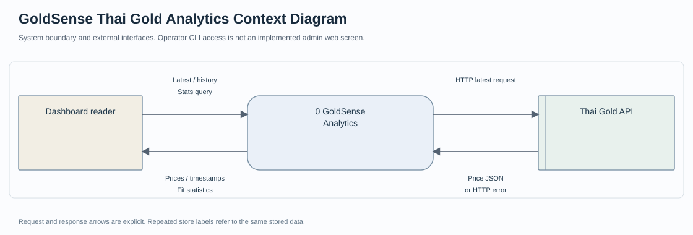
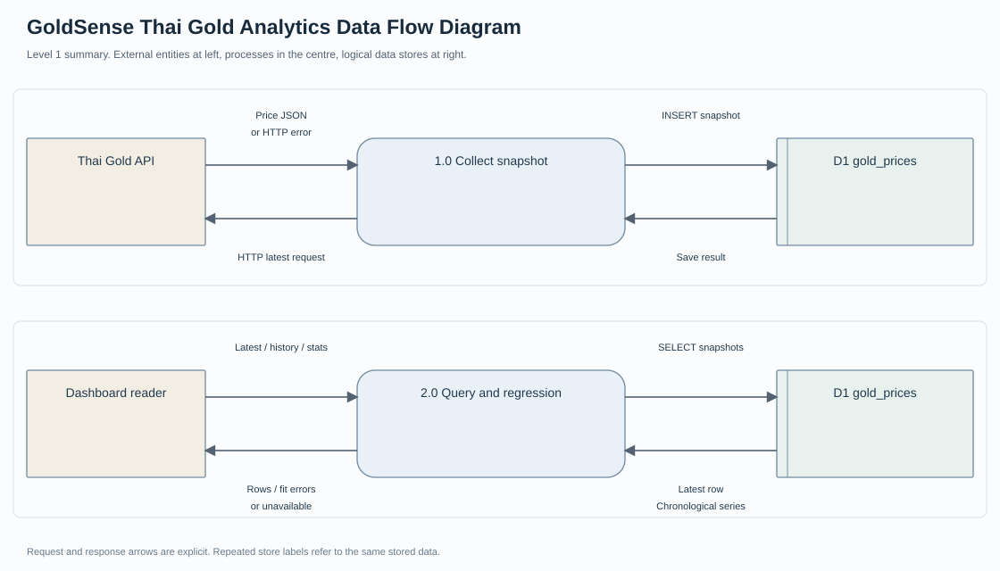
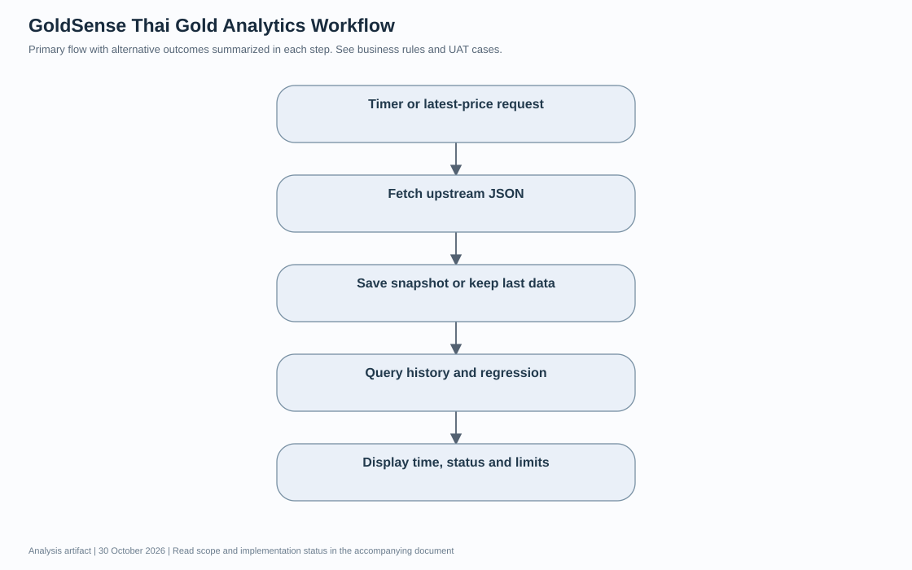
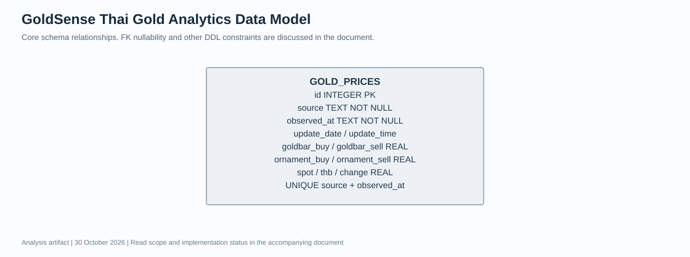

# GoldSense Thai Gold Analytics เอกสารวิเคราะห์ความต้องการและออกแบบระบบ

รุ่นเอกสาร 1.0 · วันที่ 30 October 2026 · ผู้จัดทำ Panupong Intasan โดยใช้ AI assistance ใน ChatGPT Work

รวบรวม snapshot ราคาทองคำจาก API เก็บ SQLite และแสดงราคาล่าสุด/ข้อมูลย้อนหลัง พร้อม linear regression ตัวอย่างเพื่อการศึกษา การประเมินปัจจุบันยังใช้ข้อมูลชุดเดียวกับการ fit จึงไม่ใช่หลักฐานความแม่นยำกับข้อมูลอนาคต

**สถานะเอกสาร:** จัดทำใหม่จากการอ่านโค้ด ณ commit `ba3ecf504e24fc2cd7a2983aa0bfca4c36527d7f` เพื่ออธิบายระบบและใช้ตรวจรับ ไม่ใช่บันทึกการสัมภาษณ์หรือหลักฐานว่าผู้มีส่วนได้ส่วนเสียอนุมัติ Requirement แล้ว รายการที่ยังต้องตัดสินใจอยู่ในหัวข้อคำถามยืนยัน

[อ่านฉบับเว็บบน Portfolio](https://intasan.github.io/portfolio/analysis/gold-thai/index.html) · [ไฟล์ HTML](analysis.html) · [Diagram source](diagrams/)

## 1 เป้าหมาย ผู้ใช้งาน และขอบเขต

| ผู้เกี่ยวข้อง | หน้าที่ |
| --- | --- |
| ผู้ดูข้อมูล | เปิดราคาล่าสุด เลือกช่วงย้อนหลัง และอ่านสถานะข้อมูล |
| Thai Gold API | ส่ง JSON ราคาล่าสุด เป็น wrapper ที่โค้ดระบุว่าอ้างอิงสมาคมค้าทองคำ |
| ผู้ดูแลระบบ | กำหนด endpoint และ DB_FILE ดูแลไฟล์ฐานข้อมูลและการเชื่อมต่อ |

**อยู่ในขอบเขต:** Fetch ล่าสุดทุก 60 วินาทีและเมื่อเรียก latest; เก็บ snapshots, history endpoint และสถิติ regression

**อยู่นอกขอบเขต:** ระบบซื้อขาย การแนะนำลงทุน ข้อมูลย้อนหลัง 1 ปีที่เติมอัตโนมัติ และโมเดลที่ผ่านการทดสอบนอกชุดฝึก

## 2 วิธีเก็บและยืนยันความต้องการ

เอกสารรอบนี้ใช้ source review, schema review และผลทดสอบที่มีอยู่เป็น input ข้อกำหนดแบบ As implemented ใช้อธิบายพฤติกรรมที่พบในโค้ด ส่วน To be เป็นข้อเสนอหรือคำถามที่ยังไม่ได้อนุมัติ ไม่มีการสร้างชื่อผู้ให้สัมภาษณ์ วันประชุม หรือผลลงนามย้อนหลัง

กระบวนการยืนยันที่เสนอคือให้ผู้ใช้งานหลักทบทวน scope และ Business Rules จากนั้นเดินผ่าน scenario ปกติและข้อผิดพลาด บันทึกคำตอบพร้อมผู้ตัดสินใจ แล้วปรับ version ของ Requirement และ UAT ก่อนรับรองการใช้งานจริง

## 3 Functional Requirements และเกณฑ์ยอมรับ

ทุกแถวต่อไปนี้เป็น **As implemented จากโค้ด** คอลัมน์หลักฐานแยกสิ่งที่มีการทดสอบเดิมกับสิ่งที่เพียงพบใน source การจัดทำเอกสารไม่ได้ทำให้ผลทดสอบที่ยังรออยู่กลายเป็นผ่าน

| รหัส | ความต้องการ | เกณฑ์ยอมรับ | Source | หลักฐานหรือสถานะ |
| --- | --- | --- | --- | --- |
| G-FR01 | ดึงราคาจาก endpoint ที่กำหนด | ใช้ THAI_GOLD_API_URL หรือค่าเริ่มต้น และตรวจ HTTP status | server.js | พบในโค้ด ยังไม่ยืนยัน feed รอบนี้ |
| G-FR02 | แปลงค่าราคาเป็นตัวเลข | อ่านราคาซื้อขายทองแท่ง/รูปพรรณและ metadata จาก JSON | server.js | ต้องทดสอบ payload จริงและผิดรูป |
| G-FR03 | บันทึก snapshot ใน SQLite | เก็บ source, observed_at, update_date/time และค่าราคา | server.js | พบใน DDL และ save() |
| G-FR04 | ซิงก์อัตโนมัติ | sync ตอน startup และทุก 60000 ms | server.js | พบในโค้ด |
| G-FR05 | คืนราคาที่ดึงใหม่หรือข้อมูลเก่า | /api/latest มี ok, live และ last; การดึงล้มเหลวไม่ควรสร้างราคาปลอม | server.js | พบในโค้ด ต้องทดสอบ failover |
| G-FR06 | อ่านประวัติเรียงตามเวลาที่สังเกต | /api/history กรอง observed_at ตาม days | server.js | พบในโค้ด ต้องทดสอบ input validation |
| G-FR07 | คำนวณ baseline จากลำดับแถว | /api/stats fit เส้นตรงบน goldbar_sell ที่ไม่ null และคาดค่าลำดับถัดไป | server.js | พบในโค้ด ยังไม่ใช่ next-day forecast |
| G-FR08 | ไม่แสดงตัวเลขสถิติเมื่อมีน้อยกว่า 2 แถว | คืน mae rmse forecast เป็น null | server.js | พบในโค้ด |
| G-FR09 | แสดง Dashboard และเลือกช่วงย้อนหลัง | หน้าเว็บเรียก latest/history/stats และ Chart.js | public/index.html | ยังไม่รันสำเร็จในสภาพแวดล้อมนี้ |
| G-FR10 | ตรวจ process health | GET /api/health คืน ok และเวลา process | server.js | พบในโค้ด ไม่ตรวจ upstream/DB แบบ readiness |

## 4 Business Rules

1. observed_at เป็นเวลาที่ระบบดึง ไม่ใช่เวลาประกาศจาก upstream
2. UNIQUE(source, observed_at) ไม่ป้องกันการเก็บราคาประกาศเดียวซ้ำในรอบ sync ใหม่
3. regression ใช้ index แถวเป็นแกน x ไม่ใช่จำนวนวัน; forecast คือ snapshot index ถัดไป
4. MAE/RMSE ปัจจุบันเป็น in-sample fit errors; ห้ามนำไปอ้างว่าเป็นผล held-out test
5. หากมีข้อมูลเก่า last ต้องแสดงเวลาประกอบ ไม่ควรตีความว่าเป็นข้อมูลสด

## 5 Non Functional Requirements

| รหัส | ประเด็น | เกณฑ์และสถานะ |
| --- | --- | --- |
| gold-thai-NFR01 | Data integrity | ใช้การตรวจสอบ input และการบันทึกที่สอดคล้องกับ business rules; ดูข้อจำกัดรายโครงการด้านล่าง |
| gold-thai-NFR02 | Access control | ตรวจสิทธิ์ที่ server ตาม actor และ endpoint; ไม่อ้างสิทธิ์ที่ระบบยังไม่มี |
| gold-thai-NFR03 | Observability | ต้องอธิบาย error / unavailable และ provenance ที่มีอยู่; audit trail แบบสมบูรณ์ยังไม่ถือว่ามี |
| gold-thai-NFR04 | Usability | เสนอให้ทดสอบ desktop และ mobile ตั้งแต่ 360 px พร้อม keyboard; ยังไม่มีผลตรวจครบทุกขนาด |
| gold-thai-NFR05 | Performance | ยังไม่มี SLA ที่ผู้เกี่ยวข้องอนุมัติ ต้องกำหนดจำนวนผู้ใช้และเกณฑ์ response time ก่อน load test |
| gold-thai-NFR06 | Recovery | เสนอให้ทดสอบสำรองและกู้คืนข้อมูลพร้อมไฟล์ที่สัมพันธ์กัน; RPO/RTO ยังต้องตกลง ไม่กำหนดตัวเลขแทนผู้ใช้ |

## 6 Context Diagram

อ่านร่วมกับ [Mermaid context source](diagrams/context.mmd) ซึ่งแสดงข้อมูลขาเข้าและขาออกแยกทิศทาง Context Diagram กำหนดขอบเขตระบบทั้งก้อน ไม่แสดง data store ภายใน

## 7 Data Flow Diagram และทะเบียนข้อมูล

ภาพ SVG เป็น process overview แบบย่อ ส่วน [DFD Mermaid source](diagrams/data-flow.mmd) และทะเบียนด้านล่างแสดงทิศทาง request/response และ data store อย่างละเอียด ห้ามตีความลูกศรเป็นลำดับเวลาดำเนินงานอย่างเดียว

| Flow | ต้นทาง | ปลายทาง | ข้อมูลที่ส่งไป | ข้อมูลตอบกลับ |
| --- | --- | --- | --- | --- |
| D01 | Timer / latest request | 1.0 Collect | trigger | sync result หรือ null |
| D02 | 1.0 Collect | Thai Gold API | HTTP latest request | JSON หรือ HTTP error |
| D03 | 1.0 Collect | D1 gold_prices | INSERT snapshot | persist result |
| D04 | Dashboard | 2.0 Query / regression | latest/history/stats request | ราคา history stats หรือ error |
| D05 | 2.0 Query / regression | D1 gold_prices | อ่าน latest และ non-null sell series | rows ที่เรียง observed_at |

## 8 Workflow

1. รับ trigger ตามรอบหรือคำขอ latest
2. เรียก API และแปลง JSON
3. บันทึก snapshot หรือใช้ last หากล้มเหลว
4. อ่าน history และคำนวณ regression
5. แสดงราคา เวลา และข้อจำกัด

ข้อผิดพลาดต้องส่งผลตาม Requirement ที่เกี่ยวข้องและไม่ข้ามการตรวจสิทธิ์หรือความถูกต้องของข้อมูล [แก้ไข Mermaid workflow](diagrams/workflow.mmd)

## 9 Data Model และ Data Dictionary

แบบจำลองแสดง core entities ตาม schema ที่ตรวจอ่าน ความสัมพันธ์ที่แอปคาดหวังอาจเข้มกว่าข้อจำกัด nullable ของฐานข้อมูล จึงต้องอ่าน DDL และ validation ประกอบ

| Entity หรือ data store | ข้อมูลหลัก |
| --- | --- |
| GOLD_PRICES | id INTEGER PK; source TEXT NOT NULL; observed_at TEXT NOT NULL; update_date / update_time; goldbar_buy / goldbar_sell REAL; ornament_buy / ornament_sell REAL; spot / thb / change REAL; UNIQUE source + observed_at |

มีตารางหลักเดียว ไม่มีความสัมพันธ์ระหว่างตาราง; UNIQUE ใช้ source กับ observed_at ไม่ใช่ upstream announcement ID

Single table model ไม่มีความสัมพันธ์ระหว่างตาราง

[Mermaid data model source](diagrams/data-model.mmd)

## 10 UAT และ Requirement Traceability

ตารางนี้เป็น test design และ mapping กับหลักฐานที่มี การผ่าน unit/API test ไม่เท่ากับผู้ใช้ปลายทางลงนาม UAT

| Test ID | Requirement | ขั้นตอนหรือ input | ผลคาดหวัง | สถานะหลักฐาน |
| --- | --- | --- | --- | --- |
| G-UAT01 | G-FR01 G-FR03 | upstream ตอบ payload ที่ตรวจแล้ว | บันทึกราคา/หน่วย/เวลาตาม payload | รอตรวจรับ |
| G-UAT02 | G-FR05 | upstream ตอบ 500 โดยมีข้อมูลเดิม | live null และ last เป็นแถวเดิม ไม่สร้างข้อมูลใหม่ | รอตรวจรับ |
| G-UAT03 | G-FR08 | มีข้อมูล 0 หรือ 1 แถว | สถิติเป็น null | รอตรวจรับ |
| G-UAT04 | G-FR07 | ชุดราคาคงที่ที่ใช้เฉพาะ unit test | ค่าความชันและ errors ตรงสูตร ไม่เผยเป็นข้อมูลตลาด | รอตรวจรับ |
| G-UAT05 | G-FR06 | days เป็นข้อความหรือไม่ใช่ค่าจำกัด | ต้องปฏิเสธอย่างชัดเจน เป็นข้อเสนอที่ยังต้องแก้ | ยังไม่มี validation ครบ |
| G-UAT06 | G-FR09 | ตัดเครือข่ายแล้วเปิด UI | แจ้ง unavailable หรือเวลา last ตามจริง | รอตรวจรับ |

**ผู้ตรวจรับ:** ยังไม่กำหนด · **วันที่ตรวจรับกับผู้ใช้:** ยังไม่ดำเนินการในรอบเอกสารนี้ · **ผลลงนาม:** ยังไม่มี

## 11 ข้อจำกัดและความเสี่ยง

- better-sqlite3 รุ่นเดิมติดตั้งไม่สำเร็จบน Node.js 24 ในรอบก่อน จึงยังไม่อ้างว่าได้รันระบบนี้สำเร็จ
- ยังไม่มี timeout และ payload validation ที่ครบถ้วน รวมถึงอาจเกิดการอ่าน history ก่อน latest บันทึกเสร็จเพราะ UI เรียกแบบขนาน
- ต้องแยก holdout test และ time horizon ก่อนใช้คำว่า forecast accuracy

## 12 คำถามที่ต้องยืนยันก่อนขยายระบบ

1. ต้องการหนึ่ง snapshot ต่อการดึง หรือหนึ่งแถวต่อประกาศราคาที่ไม่ซ้ำ
2. ต้องการพยากรณ์ล่วงหน้ากี่ชั่วโมงหรือกี่วัน และใช้ timestamp ใดเป็นแกนเวลา
3. จะจัดแบ่ง train/test ตามลำดับเวลาและเทียบ naive baseline อย่างไร
4. เกณฑ์ stale data และเวลารอ upstream ที่ยอมรับได้คือเท่าไร
5. สิทธิ์ใช้ API และเผยแพร่ประวัติราคากำหนดไว้อย่างไร

## 13 Source Baseline และประวัติเอกสาร

- [server.js](https://github.com/intasan/thai-gold-price-forecast/blob/ba3ecf504e24fc2cd7a2983aa0bfca4c36527d7f/server.js)
- [public/index.html](https://github.com/intasan/thai-gold-price-forecast/blob/ba3ecf504e24fc2cd7a2983aa0bfca4c36527d7f/public/index.html)
- [package.json](https://github.com/intasan/thai-gold-price-forecast/blob/ba3ecf504e24fc2cd7a2983aa0bfca4c36527d7f/package.json)
- [README.md](https://github.com/intasan/thai-gold-price-forecast/blob/ba3ecf504e24fc2cd7a2983aa0bfca4c36527d7f/README.md)

| Version | วันที่ | รายการเปลี่ยนแปลง |
| --- | --- | --- |
| 1.0 | 30 October 2026 | จัดทำ requirement catalogue, data flow register, diagrams, data dictionary และ UAT traceability จาก source baseline |

เอกสารวิเคราะห์และไดอะแกรมเป็น deliverable ใหม่ ไม่ใช่ภาพหน้าจอหรือหลักฐานผลการทำงานที่ยังไม่ได้ทดสอบ ไม่มีการอ่านหรือแก้ repository ที่ผู้ใช้ระบุให้ยกเว้น
